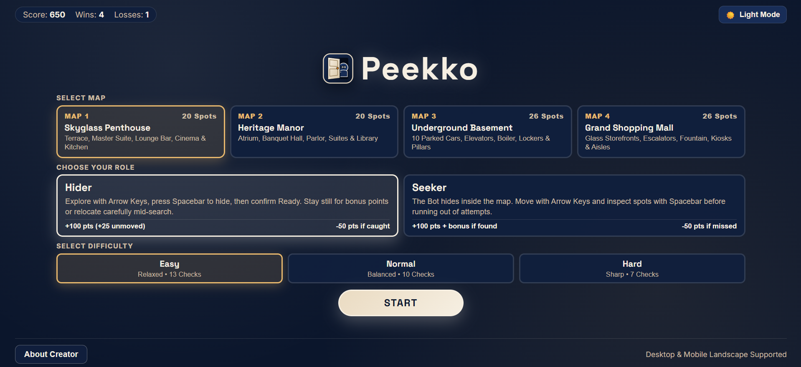

# 🎮 Peekko — A Smart Hide-and-Seek Game

**Hide smart. Search carefully. Outsmart your opponent.**

Peekko is a fast-paced, browser-based hide-and-seek strategy game where you either hide from intelligent AI Seekers or hunt them down across five detailed environments — now featuring **"Play with Friends" (Custom Room)** online multiplayer for 2 to 5 players with instant cross-network mobile & Wi-Fi support!

Choose your role, explore handcrafted maps, use strategic hiding spots, and outsmart your opponents through stealth, positioning, and split-second decisions.

Built with HTML5 Canvas, vanilla JavaScript, CSS, and WebRTC (PeerJS), Peekko delivers an interactive gaming experience without relying on external game engines or heavy frameworks.

<p align="center">
  
</p>

---

### Live Demo
Play **Peekko** directly in your browser: **[https://peekko.vercel.app](https://peekko.vercel.app)**

---

## 📖 About Peekko

Peekko is a browser-based stealth strategy game built around the classic concept of hide-and-seek, featuring both an intelligent single-player AI mode and a full-featured real-time **Play with Friends (Custom Room)** online multiplayer mode.

Players can choose between two roles:

- **Hider:** Sneak around the environment, find the perfect hiding place, and survive while the Seeker systematically searches the map.
- **Seeker:** Track down hidden opponents by exploring the environment, listening for footsteps, and inspecting potential hiding spots before running out of attempts.

Every round creates a different tactical challenge. Players must consider hiding locations, movement sound, lighting cones, line of sight, and search patterns to win.

Your single-player score, wins, losses, selected map, theme, volume, and difficulty preferences are saved locally in your browser.

---

## ✨ Features

### 👥 Play with Friends (Custom Room Multiplayer)

Connect with friends and play private multiplayer matches (2 to 5 players) without requiring any backend server, accounts, or API keys:

- **Cross-Network Hybrid Transport (MQTT + WebRTC):** Operates over secure WebSockets with public MQTT relay plus PeerJS WebRTC mesh. 100% reliable connections across Mobile Data (4G/5G CGNAT) and Wi-Fi networks worldwide without timeouts or port blocks!
- **5-Character Room Codes & Shareable Invite Links:** Generate short room codes (e.g. `PK492`) with "📋 Copy Code", "📋 Paste Code", and "🔗 Invite Link" (`?room=PKXYZ`) for instant one-click auto-joining.
- **Interactive Lobby Table:** Live player list with high-contrast color badges, ready statuses, map selector, and player-directed role selection (Hider / Seeker).
- **20-Second Hiding Phase:** Hiders receive 20 seconds to navigate the map and hide in spots. The Seeker's movement is locked and all Hiders remain completely invisible to the Seeker during this countdown.
- **Fair Asymmetric Visibility:** Hiders can see the Seeker, fellow Hiders, and the Seeker's flashlight cone in Night mode. The Seeker *cannot* see hidden players or players behind walls without direct line-of-sight.
- **Mid-Hunt Relocation:** Hiders can leave their spot mid-search and sprint to a new location if the Seeker is getting uncomfortably close.
- **Spectator Elimination Mode:** When caught, a player becomes an active spectator able to watch the rest of the hunt unfold.
- **Ranked Match Leaderboard:** Complete end-of-match rankings (1st, 2nd, 3rd...) with detailed justifications (*Apex Hunter*, *Unmoved Stealth Master (+25 Bonus)*, *Tactical Survivor*), plus "Return to Lobby" to play another round together.

### 🎯 Two Gameplay Roles

- Play as either the Hider or the Seeker.
- Switch roles after every round.
- Each role has its own objectives, scoring rules, and gameplay mechanics.
- Different strategies are required to survive or successfully locate opponents.

### 🗺️ Five Detailed Maps

Explore five unique environments, each featuring its own atmosphere, layout, obstacles, and hiding locations:

| Map | Environment | Hiding Spots |
|---|---|---:|
| Skyglass Penthouse | Terrace, master suite, lounge bar, cinema, and kitchen | 20 |
| Heritage Manor | Grand atrium, banquet hall, parlor, suites, and library | 20 |
| Underground Basement | Parked cars, elevators, boiler room, lockers, and pillars | 26 |
| Grand Shopping Mall | Storefronts, concourse, food court, kiosks, and retail aisles | 26 |
| Wonderland Park | Amusement rides, Ferris wheel, carousel, midway booths & haunted zone | 40 |

### 🤖 Intelligent AI Seeker (Solo Mode)

The AI Seeker uses rule-based decision-making and pathfinding to search for the hidden player:

- **Systematic Room Searching:** Sweeps rooms methodically instead of wandering aimlessly.
- **Navigation Graph & Unstuck Maneuvers:** Finds routes around walls and glides smoothly through doorways.
- **Directional Vision Cone:** Uses realistic line of sight to detect exposed players.
- **Acoustic Detection:** Can hear player footsteps in nearby rooms and investigate noise.
- **Weighted Rechecking:** Re-evaluates previously visited areas if the player relocated.

### 🔥 Hot / Warm / Cool Search Hints

When playing as the Seeker, empty searches provide tactile proximity hints:

- **Hot:** The hidden opponent is very close.
- **Warm:** An opponent is nearby.
- **Cool:** Opponents are farther away.

### ⚡ Three Difficulty Levels (Solo Mode)

| Setting | Easy | Normal | Hard |
|---|---:|---:|---:|
| Seeker Attempts | 13 | 10 | 7 |
| Bot Checks as Hider | 7 (1 Bot) | 10 (1 Bot) | 14 (2 Bots: 7 each) |
| Active Seekers as Hider | 1 | 1 | 2 (Alpha & Beta) |
| Bot Speed | Slower | Standard | Balanced (~1.2x pacing) |
| Search Hints | Hot, Warm, Cool | Hot, Warm, Cool | Hot only |

- **Hard Mode Dual Seekers (Full Persistence):** In Hard Mode when playing as Hider, two seeker bots (Amber Seeker Alpha and Crimson Seeker Beta) hunt simultaneously across different rooms with independent search paths and 14 combined checks. Both bots remain actively hunting and visible on screen until the very end of the round with balanced realistic pacing (~1.2x ratio). When playing as Seeker, the challenge remains 7 strategic attempts to locate the hidden bot.

### 🔊 Procedural Web Audio Engine

Peekko generates all audio effects procedurally using the **Web Audio API** without external audio files:

- Distinct footsteps on wood, tile, and concrete.
- Spatial audio attenuation and wall sound-muffling.
- Tense proximity heartbeat for hiders when the seeker gets close.
- Master volume slider and instant mute toggle.

### 🎨 Themes & Mobile Support

- Dark Mode and Light Mode with responsive top-down architectural styling.
- Fullscreen and mobile landscape support with on-screen D-pad and action buttons.
- Keyboard accessible menus with visible focus indicators.

---

## 🕹️ How to Play

### Controls

| Action | Keyboard | Touch |
|---|---|---|
| Move | Arrow Keys / W A S D | On-screen D-pad |
| Hide / Relocate / Search | `Space` | SPACE button |
| Confirm "I'm Ready" (Hider) | `Enter` | READY button |
| Pause / Resume | `Esc` | Pause button |

---

### Playing in Custom Rooms (Multiplayer)

1. From the main menu, click **Play with Friends (Custom Room)**.
2. **Create Room:** Enter your name, choose the map, your initial role, seeker attempts limit (7, 10, 15, or 20), and lighting mode (Day / Night). Click **Generate Room Code** and copy the 5-character code (e.g. `PK492`) to share with friends.
3. **Join Room:** Friends click **Join Room**, enter their name and the room code, and click **Join Room**.
4. **Lobby & Roles:** In the lobby, the Host can toggle who acts as the Seeker (exactly 1 Seeker required).
5. **Start Match:** Once 2 to 5 players are connected, the Host clicks **Start Match**.
6. **20-Second Hiding Phase:** Hiders have 20 seconds to infiltrate the map and hide (`Space`). The Seeker's movement is locked and all Hiders are completely invisible during this countdown.
7. **The Hunt:** When the countdown hits 0, the Seeker is unleashed to search rooms, inspect spots (`Space`), and catch any Hiders spotted in the open!
8. **Results & Rematch:** View the final ranked podium with stealth bonus justifications and click **Return to Lobby** to play again with new roles.

---

### Playing as the Hider (Solo)

1. Choose your map and select the Hider role.
2. Move around and explore available hiding locations.
3. Approach an object and press `Space` to hide.
4. Press `Enter` or the Ready button to begin the search.
5. Survive all the bot's checks without getting caught.

**Strategy Tips:**
- Staying in your original hiding spot earns a **+25 Unmoved Stealth Bonus**.
- You can move to another hiding spot while the bot is searching, but running creates noise.

---

### Playing as the Seeker (Solo)

1. Select the Seeker role.
2. The bot chooses a hiding location.
3. Explore the map and approach suspect hiding spots.
4. Press `Space` to inspect a location.
5. Follow Hot, Warm, and Cool clues to narrow down the opponent's position before attempts run out.

---

## 🏆 Scoring System (Solo Mode)

| Outcome | Score |
|---|---:|
| Hider survives all checks | +100 |
| Hider survives without leaving the original spot | +25 bonus |
| Hider gets caught | -50 |
| Seeker finds the hidden bot | +100 |
| Seeker finds the bot with remaining attempts | +15 per unused attempt |
| Seeker runs out of attempts | -50 |

Score protection ensures your total score will never drop below zero.

---

## 🛠️ Built With

Peekko is developed with clean web standards without external game engines or frameworks:

| Technology | Purpose |
|---|---|
| HTML5 & Canvas API | Application structure, top-down map, character & visual-effect rendering |
| CSS3 | Responsive UI, theme variables, glassmorphic HUD styling |
| Vanilla JavaScript (ES6) | Game state, navigation mesh, bot AI, and collision physics |
| PeerJS & Paho MQTT | Cross-network hybrid WebRTC + WebSocket relay for seamless Mobile Data & Wi-Fi multiplayer |
| Web Audio API | Procedural sound generation, spatial attenuation, and proximity heartbeat |
| localStorage | Local progress, high scores, and preference persistence |

---

## 🚀 Getting Started

Peekko is a static browser application. There is no installation or build process required.

### Prerequisites

- A modern web browser with WebRTC and Web Audio support (Chrome, Firefox, Edge, Safari).
- Python 3 (recommended for local hosting).

### Run Locally

**1. Clone the repository**

```bash
git clone https://github.com/RI-Rimon/Peekko.git
```

**2. Navigate to the project directory**

```bash
cd Peekko
```

**3. Start a local HTTP server**

```bash
python -m http.server 8080
```

**4. Open the game**

Visit the following address in your browser:

```text
http://localhost:8080
```

---

## 📂 Project Structure

```text
Peekko/
├── assets/
│   ├── peekko-icon.svg    # Game brand logo and favicon
│   └── screenshot.png     # Visual preview
│
├── css/
│   └── style.css          # Core styles, themes, and multiplayer HUD
│
├── js/
│   ├── config.js          # Central game tuning and multiplayer configuration
│   ├── apartment.js       # Map layouts, navigation nodes, and collision clearance
│   ├── audio.js           # Procedural Web Audio sound effects engine
│   ├── renderer.js        # Architectural top-down canvas rendering and visibility
│   ├── multiplayer.js     # PeerJS host-authoritative custom rooms & sync
│   └── game.js            # Core game state, solo AI behaviour, and input handling
│
├── README.md              # Documentation and game guide
├── LICENSE                # MIT License
└── index.html             # Application structure and UI modals
```

---

## 🔮 Future Roadmap — Peekko v2

Peekko v2 is planned to expand the experience further:

- **Public Matchmaking:** Random quick-match queue alongside custom rooms.
- **Bigger Environments:** Expansive industrial and outdoor maps with 40+ hiding spots.
- **Enhanced Visuals:** Animated environmental elements, weather effects, and object interactions.
- **Downloadable Edition:** Desktop packaging for offline play.

---

## ⚠️ Known Limitations

- Custom Room multiplayer supports 2 to 5 players over WebRTC via PeerJS; public random matchmaking is planned for future releases.
- Player solo progress is stored in browser `localStorage`; clearing site data resets saved records.
- Google Fonts and PeerJS CDN require an internet connection; system fonts are used as fallbacks.

---

## 🤝 Feedback & Contributions

Ideas, suggestions, and feedback are welcome! If you find a bug or have an idea for improving Peekko, feel free to open an issue in the repository.

---

## 👨‍💻 About the Developer

Peekko was conceptualized, designed, and planned by **Redwanul Islam Rimon**.

The implementation was developed with AI coding assistance and refined through iterative review, testing, and engineering improvements.

**Connect with me:**

- Portfolio: [redwanulrimon.vercel.app](https://redwanulrimon.vercel.app/)
- LinkedIn: [Redwanul Islam Rimon](https://www.linkedin.com/in/redwanul-rimon/)
- GitHub: [RI-Rimon](https://github.com/RI-Rimon)

---

## 📄 License

Peekko is released under the **MIT License**.
